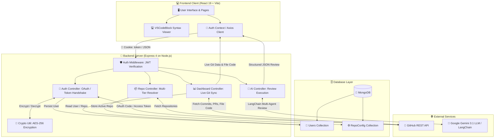
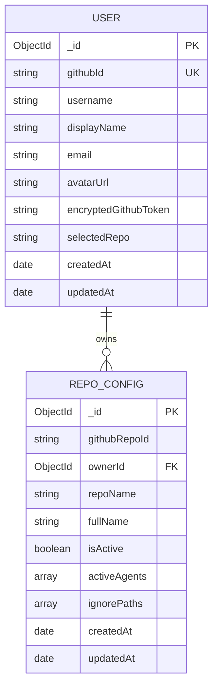

# 🚀 ReviseIQ — AI-Powered Automated Code Review & Repository Intelligence

> 🤖 **Automated, multi-agent code intelligence and pull request review platform powered by Google Gemini and LangChain.** ReviseIQ analyzes repository codebases, detects security vulnerabilities 🛡️, flags performance bottlenecks ⚡, evaluates architectural clarity 📐, and generates production-ready refactors with high-fidelity VS Code syntax highlighting 💻.

---

## 📋 Table of Contents

1. [🌟 Project Overview](#project-overview)
   - [⚠️ Problem Statement](#problem-statement)
   - [💡 The ReviseIQ Solution](#the-reviseiq-solution)
   - [👥 Target Audience & Use Cases](#target-audience--use-cases)
2. [⚡ Core Features](#core-features)
   - [✅ Implemented Features](#implemented-features)
   - [🗺️ Planned Features (Roadmap)](#planned-features-roadmap)
3. [🛠️ Technology Stack](#technology-stack)
4. [🏗️ System Architecture](#system-architecture)
   - [📐 High-Level Architecture Diagram](#high-level-architecture-diagram)
   - [🔄 Component Interactions](#component-interactions)
5. [🔄 End-to-End Application Workflow](#end-to-end-application-workflow)
   - [🔑 Flow 1: Authentication & User Onboarding](#flow-1-authentication--user-onboarding)
   - [📁 Flow 2: Repository Discovery & Selection](#flow-2-repository-discovery--selection)
   - [⚙️ Flow 3: Agent Configuration & Audit Trigger](#flow-3-agent-configuration--audit-trigger)
   - [🧠 Flow 4: Live GitHub Code Extraction & AI Review](#flow-4-live-github-code-extraction--ai-review)
6. [📂 Folder and File Structure](#folder-and-file-structure)
7. [🔬 In-Depth Technology Deep Dives](#in-depth-technology-deep-dives)
   - [🧠 Google Gemini GenAI & LangChain Integration](#google-gemini-genai--langchain-integration)
   - [🔐 Dual-Mode Authentication & GitHub Integration](#dual-mode-authentication--github-integration)
   - [🛡️ AES-256 Token Encryption](#aes-256-token-encryption)
   - [💻 Zero-Dependency VS Code Syntax Highlighter](#zero-dependency-vs-code-syntax-highlighter)
8. [📡 API Documentation](#api-documentation)
   - [🔐 Authentication Endpoints (`/auth`)](#authentication-endpoints-auth)
   - [📦 Repository Endpoints (`/api/repos`)](#repository-endpoints-apirepos)
   - [🧠 AI & Intelligence Endpoints (`/api/ai`)](#ai--intelligence-endpoints-apiai)
   - [💓 System Endpoints](#system-endpoints)
9. [🗄️ Database Design](#database-design)
   - [📊 Entity-Relationship Diagram](#entity-relationship-diagram)
   - [📋 Data Models & Schema Definitions](#data-models--schema-definitions)
10. [🔒 Authentication & Security Implementation](#authentication--security-implementation)
11. [⚙️ Environment Variables & Configuration](#environment-variables--configuration)
12. [💻 Installation & Local Setup Guide](#installation--local-setup-guide)
13. [🎯 Step-by-Step Usage Guide](#step-by-step-usage-guide)
14. [🧪 Testing & Code Quality](#testing--code-quality)
15. [🚀 Deployment Guide](#deployment-guide)
16. [🔍 Troubleshooting & Common Issues](#troubleshooting--common-issues)
17. [🔮 Limitations & Future Improvements](#limitations--future-improvements)
18. [🤝 Contributing Guidelines](#contributing-guidelines)
19. [📄 License](#license)
20. [🙏 Acknowledgments](#acknowledgments)

---

<a id="project-overview"></a>
## 🌟 Project Overview

<a id="problem-statement"></a>
### ⚠️ Problem Statement
Modern software engineering teams face significant friction during code review cycles:
- 🥱 **Reviewer Fatigue & Bottlenecks**: Senior developers spend hours manually scanning pull requests for syntax violations, anti-patterns, and credential leaks.
- 🕳️ **Undetected Vulnerabilities**: Critical security flaws (SQL/NoSQL injection, unhandled asynchronous rejections, timing attacks) slip through manual visual reviews.
- ❓ **Vague Feedback**: Traditional linters only flag style errors without explaining *why* an issue matters or providing a drop-in replacement.
- 🔌 **Complex Local Setup**: Developers need immediate code feedback without installing heavy desktop extensions or proprietary enterprise tooling.

<a id="the-reviseiq-solution"></a>
### 💡 The ReviseIQ Solution
**ReviseIQ** acts as an autonomous virtual peer reviewer. By combining GitHub REST APIs, LangChain orchestrations, and Google Gemini 3.1 LLM models, ReviseIQ:
1. 🔗 Connects to real GitHub repositories via OAuth 2.0 or public username resolution.
2. 🔍 Automatically identifies recently committed source files or critical controllers.
3. 🤖 Deploys three specialized virtual audit agents (**Security Sentinel** 🛡️, **Performance & Complexity** ⚡, and **Architectural Clarity** 📐).
4. 📊 Produces a scored audit report (0–100 quality grade), line-by-line inspection findings with categorized severity, and a **Production-Ready Refactor** with a 1-click clipboard fix 📋.

<a id="target-audience--use-cases"></a>
### 👥 Target Audience & Use Cases
- 👨‍💻 **Individual Developers**: Self-reviewing commits before opening pull requests to public repositories.
- 🌐 **Open-Source Maintainers**: Triaging pull requests and receiving structured summaries with risk scores.
- 🏢 **Engineering Teams**: Establishing consistent security baselines and catching algorithmic bottlenecks early in the development lifecycle.

---

<a id="core-features"></a>
## ⚡ Core Features

<a id="implemented-features"></a>
### ✅ Implemented Features

| 🌟 Feature | 📝 Description | 🔧 Implementation Details |
|---|---|---|
| 🔐 **Dual-Mode Authentication** | Supports both real GitHub OAuth (with scopes for private repos) and a zero-credential Public Username Modal for developer sandboxes. | [`server/src/controllers/auth.controller.js`](server/src/controllers/auth.controller.js), Passport.js, JWT in HTTP-only cookies. |
| 🛡️ **AES-256 Token Encryption** | Protects user GitHub Personal Access Tokens and OAuth access tokens before persisting them in MongoDB. | [`server/src/utils/encryption.js`](server/src/utils/encryption.js) using native Node.js `crypto` with AES-256-CBC and random IVs. |
| 🔍 **Multi-Tier Repo Resolver** | Resolves repositories via OAuth `/user/repos`, public GitHub API, or deterministic personalized fallbacks. | [`server/src/controllers/repo.controller.js`](server/src/controllers/repo.controller.js). |
| ⏱️ **Smart Recent Commit Extractor** | Dynamically checks the latest commit (`commits[0].sha`), extracts the exact code file modified in that commit, and loads it into the editor. | [`server/src/controllers/dashboard.controller.js`](server/src/controllers/dashboard.controller.js). |
| 🤖 **Multi-Agent AI Review Pipeline** | Evaluates code against three audit dimensions: Security Sentinel, Performance & Complexity, and Architectural Clarity. | [`server/src/ai/codeReviewer.js`](server/src/ai/codeReviewer.js), LangChain `ChatGoogleGenerativeAI`, Google Gemini 3.1 Pro/Flash. |
| 🛠️ **Production-Ready Refactor Generator** | Automatically generates clean, production-ready replacement code that resolves all detected issues. | [`server/src/ai/prompts.js`](server/src/ai/prompts.js), structured JSON schema parsing. |
| 💻 **VS Code Dark Modern Code Viewer** | Fully custom, zero-dependency syntax highlighter featuring line numbers, macOS window buttons, keyword coloring, and dual Preview/Edit modes. | [`client/src/components/VSCodeBlock.jsx`](client/src/components/VSCodeBlock.jsx) with clean table-based line formatting. |
| 📊 **Interactive Metric Dashboard** | Real-time statistics including quality scores, recent commits feed, open/merged PR counts, and repository star metrics. | [`client/src/pages/DashboardPage.jsx`](client/src/pages/DashboardPage.jsx). |

<a id="planned-features-roadmap"></a>
### 🗺️ Planned Features (Roadmap)
- [ ] 🔔 **Automated GitHub Webhooks**: Automatically trigger reviews when a new pull request is opened or updated on GitHub.
- [ ] 💬 **Direct GitHub PR Commenting**: Post Gemini review comments and suggested diffs directly to GitHub pull request lines.
- [ ] 📈 **Historical Analytics & Aggregations**: MongoDB pipeline tracking code quality scores and vulnerability trends over time.
- [ ] 📏 **Custom Team Rulesets**: Allow teams to define custom AST validation rules and prompt constraints.

---

<a id="technology-stack"></a>
## 🛠️ Technology Stack

<a id="core-technologies"></a>
### 🧰 Core Technologies

| 📦 Technology | 🏷️ Category | 🎯 Purpose in ReviseIQ |
|---|---|---|
| **JavaScript (ES Modules)** 📜 | Language | Primary language for both client and server utilizing native `import`/`export` syntax. |
| **React 19** ⚛️ | Frontend Framework | Declarative UI rendering, component state management, and lifecycle hooks. |
| **Vite 8** ⚡ | Build Tool & Dev Server | Ultra-fast local development server, HMR (Hot Module Replacement), and Rollup production builds. |
| **Tailwind CSS v4** 🎨 | CSS Framework | Modern CSS styling utilizing `@theme` tokens (paper, ink, coral, gold, sage) and responsive utility classes. |
| **React Router v7** 🚦 | Routing | Client-side page navigation (`/`, `/repos`, `/onboarding`, `/dashboard`). |
| **Lucide React** 👁️ | Icons | Consistent UI icons for status badges, file indicators, and metrics. |
| **Axios** 🌐 | HTTP Client | REST API requests with `withCredentials: true` for automatic secure cookie forwarding. |
| **Node.js** 🟢 | Runtime | Asynchronous runtime powering the backend server and API layer. |
| **Express 4** 🚂 | Backend Framework | REST API routing, JSON body parsing, CORS policies, and request middleware. |
| **MongoDB & Mongoose 8** 🍃 | Database & ODM | Schema-based document persistence for users and repository configurations. |
| **Google Gemini 3.1** 🧠 | AI Model | High-throughput, large-context foundation model (`gemini-3.1-pro-preview` / `gemini-3-flash-preview`). |
| **LangChain Core & Google GenAI** 🦜🔗 | AI Orchestration | Prompt templating (`ChatPromptTemplate`), model abstraction (`ChatGoogleGenerativeAI`), and output parsing. |
| **Passport.js & Passport-GitHub2** 🛂 | Authentication | GitHub OAuth 2.0 authentication handshake and strategy management. |
| **JSON Web Tokens (`jsonwebtoken`)** 🎟️ | Session Security | Stateless, tamper-proof user session tokens stored in HTTP-only cookies. |
| **Node Crypto** 🔐 | Cryptography | Native AES-256-CBC token encryption and decryption. |
| **Cookie-Parser** 🍪 | Middleware | Extracts and verifies JWT authentication cookies from incoming client requests. |
| **Oxlint** 🦀 | Linter | High-speed Rust-based JavaScript and React linting. |

---

<a id="system-architecture"></a>
## 🏗️ System Architecture

<a id="high-level-architecture-diagram"></a>
### 📐 High-Level Architecture Diagram



<a id="component-interactions"></a>
### 🔄 Component Interactions
1. 🖥️ **Client Layer**: The client runs single-page application routing. Network calls to `/auth/*` and `/api/*` automatically transmit the `token` cookie via Axios credentials (`withCredentials: true`).
2. 🛡️ **Security Gateway**: All protected backend endpoints pass through `requireAuth` ([`server/src/middleware/auth.middleware.js`](server/src/middleware/auth.middleware.js)), which verifies the signed JWT and loads the authenticated user document.
3. 🐙 **External Sync**: When accessing dashboard analytics or repository lists, the server uses decrypted GitHub tokens to communicate with `https://api.github.com` under 5,000 req/hr rate limits.
4. 🧠 **AI Review Engine**: When reviewing code, the backend pipes structured prompts into Google Gemini via LangChain, parses the JSON response, and returns audit scores and refactored code to the frontend.

---

<a id="end-to-end-application-workflow"></a>
## 🔄 End-to-End Application Workflow

<a id="flow-1-authentication--user-onboarding"></a>
### 🔑 Flow 1: Authentication & User Onboarding
```mermaid
sequenceDiagram
    autonumber
    actor User as 👤 Developer
    participant Browser as 💻 Client (LoginPage)
    participant Server as 🚀 Backend Express
    participant GitHub as 🐙 GitHub OAuth API
    participant DB as 🍃 MongoDB (Users)

    alt 🔐 Real GitHub OAuth 2.0
        User->>Browser: Click "Continue with GitHub"
        Browser->>Server: GET /auth/github
        Server->>GitHub: Redirect to github.com/login/oauth/authorize
        User->>GitHub: Authorize ReviseIQ
        GitHub->>Server: Redirect GET /auth/github/callback?code=...
        Server->>GitHub: Exchange code for Access Token
        Server->>Server: Encrypt Access Token with AES-256
        Server->>DB: Upsert User Document (githubId, encryptedGithubToken)
        Server->>Browser: Set-Cookie: token=<JWT>; Redirect /repos
    else 🧪 Public Username Sandbox
        User->>Browser: Enter username in Modal (e.g. "octocat")
        Browser->>Server: GET /auth/connect-real-user?username=octocat
        Server->>GitHub: GET /users/octocat (Public Profile)
        Server->>DB: Upsert User (dummy PAT, public avatar, username)
        Server->>Browser: Set-Cookie: token=<JWT>; Redirect /repos
    end
```

<a id="flow-2-repository-discovery--selection"></a>
### 📁 Flow 2: Repository Discovery & Selection
1. 🌐 Client routes to `/repos` and calls `GET /api/repos`.
2. 🔓 Backend decrypts the user's stored GitHub token:
   - If a real token exists: Queries `https://api.github.com/user/repos` (supports both public and private repositories).
   - If username-only: Queries `https://api.github.com/users/:username/repos` for public repositories.
   - If rate-limited or 0 repositories: Returns deterministic, personalized sample repositories (`<username>/ReviseIQ`, `<username>/core-service`).
3. 👆 User selects a repository and clicks **"Start Automated Review"**.
4. 📡 Client sends `POST /api/repos/select` with `{ repoId, fullName, repoName }`.
5. 💾 Backend updates the user's `selectedRepo` field in MongoDB and upserts a `RepoConfig` record.

<a id="flow-3-agent-configuration--audit-trigger"></a>
### ⚙️ Flow 3: Agent Configuration & Audit Trigger
1. 🖥️ Client routes to `/onboarding`, displaying the selected repository.
2. 🎛️ User toggles the desired review agents:
   - 🛡️ `security`: Checks for injections, credential exposure, and CVEs.
   - ⚡ `performance`: Analyzes algorithmic complexity, loop performance, and indexing.
   - 📐 `clarity`: Evaluates naming conventions, type boundaries, and modularization.
3. 🚀 User clicks **"Launch Dashboard Review"**.
4. 🧭 Client routes to `/dashboard` with router state `{ repo, activeAgents, autoReview: true }`.

<a id="flow-4-live-github-code-extraction--ai-review"></a>
### 🧠 Flow 4: Live GitHub Code Extraction & AI Review
1. 📡 `DashboardPage` calls `GET /api/ai/dashboard-data?repo=owner/repo`.
2. ⚡ Backend queries GitHub in parallel:
   - Fetches recent commits (`/repos/owner/repo/commits?per_page=10`).
   - Fetches open/merged pull requests (`/repos/owner/repo/pulls`).
   - Fetches repository statistics (stars ⭐, forks 🍴, open issues ⚠️).
   - **Extracts the most recently committed file**: Fetches commit details for `commits[0].sha`, identifies the modified code file, and fetches its raw content.
3. 📦 Backend returns live GitHub metrics and the extracted source code.
4. 🤖 Client automatically triggers `POST /api/ai/review` with `{ code, filename, language, activeAgents }`.
5. 🦜🔗 LangChain formats `CODE_REVIEW_PROMPT` and invokes `gemini-3.1-pro-preview` (with automatic fallback to `gemini-3.1-flash-lite-preview` on rate limits).
6. 📋 Gemini returns a structured JSON evaluation.
7. ✨ Frontend updates:
   - Quality score gauge (0–100) 🎯.
   - Status badge (`PASS` 🟢 / `FLAG` 🟡 / `FAIL` 🔴).
   - Executive summary and categorized findings 📝.
   - **Recommended Production-Ready Refactor** rendered inside the VS Code syntax highlighter with a 1-click **Copy Fix** button 📋.

---

<a id="folder-and-file-structure"></a>
## 📂 Folder and File Structure

```
ReviseIQ/
├── 📄 README.md                      # Complete project documentation
├── 📁 client/                        # React 19 Frontend Application
│   ├── ⚙️ .oxlintrc.json             # Oxlint linter configuration
│   ├── 🌐 index.html                 # HTML template with Google Fonts (DM Sans, Space Mono)
│   ├── 📦 package.json               # Client dependencies and build scripts
│   ├── 🎨 postcss.config.js          # PostCSS configuration with Tailwind v4 & Autoprefixer
│   ├── ⚡ vite.config.js             # Vite configuration with proxy settings
│   ├── 📂 public/                    # Static assets (favicons, SVG icons)
│   └── 📂 src/
│       ├── 🎨 App.css                # Global supplementary CSS
│       ├── ⚛️ App.jsx                # Main application routing and AuthProvider wrapper
│       ├── 🎨 index.css              # Tailwind v4 theme definitions and font setups
│       ├── 🚀 main.jsx               # Application entry point with BrowserRouter
│       ├── 🖼️ assets/                # App artwork and logos
│       ├── 🧩 components/
│       │   └── 💻 VSCodeBlock.jsx    # Custom VS Code Dark Modern syntax highlighter
│       ├── 🔐 context/
│       │   └── 🛡️ AuthContext.jsx    # Global React Context for user authentication state
│       ├── 📡 lib/
│       │   └── 🌐 api.js             # Pre-configured Axios instance (withCredentials: true)
│       └── 📄 pages/
│           ├── 📊 DashboardPage.jsx  # Main metrics, code viewer, and AI evaluation dashboard
│           ├── 🔑 LoginPage.jsx      # Split-screen hero landing and authentication modal
│           ├── ⚙️ OnboardingPage.jsx # AI agent selector and review configuration
│           └── 📦 RepoPage.jsx       # Repository search, filter, card/markdown view, and selector
└── 📁 server/                        # Node.js + Express Backend Application
    ├── ⚙️ .env.example               # Safe environment variable configuration template
    ├── 🚀 index.js                   # Server entry point, middleware setup, route mounting
    ├── 📦 package.json               # Server dependencies and execution scripts
    └── 📂 src/
        ├── 🧠 ai/                    # LangChain & Google Gemini AI Pipeline
        │   ├── 🤖 codeReviewer.js    # Review chains for source code and PR diffs
        │   ├── ⚙️ config.js          # Gemini model initializer and name normalizer
        │   ├── ⚡ geminiService.js   # Direct text generation, streaming, code explanation
        │   ├── 📦 index.js           # Public exports for the AI module
        │   └── 📝 prompts.js         # ChatPromptTemplate definitions and JSON schemas
        ├── ⚙️ config/
        │   ├── 🗄️ db.js              # Mongoose MongoDB connection handler
        │   └── 🔐 passport.js        # Passport GitHub Strategy configuration
        ├── 🎮 controllers/
        │   ├── 🧠 ai.controller.js   # HTTP controllers for AI reviews, explanation, fixes
        │   ├── 🔑 auth.controller.js # Authentication, OAuth callbacks, profile resolutions
        │   ├── 📊 dashboard.controller.js # Live GitHub data fetcher & commit file extractor
        │   └── 📦 repo.controller.js # Repository fetching and active repository selection
        ├── 🛡️ middleware/
        │   └── 🔒 auth.middleware.js # requireAuth and optionalAuth JWT verification guards
        ├── 🗄️ models/
        │   ├── ⚙️ RepoConfig.js      # Mongoose schema for repository audit settings
        │   └── 👤 User.js            # Mongoose schema for user accounts & encrypted tokens
        ├── 🚦 routes/
        │   ├── 🧠 ai.routes.js       # Endpoints for /api/ai
        │   ├── 🔑 auth.routes.js     # Endpoints for /auth
        │   └── 📦 repo.routes.js     # Endpoints for /api/repos
        └── 🛠️ utils/
            ├── 🛡️ encryption.js      # AES-256-CBC token encryption & decryption
            └── 🔑 jwt.js             # JWT signing and verification utility functions
```

---

<a id="in-depth-technology-deep-dives"></a>
## 🔬 In-Depth Technology Deep Dives

<a id="google-gemini-genai--langchain-integration"></a>
### 🧠 Google Gemini GenAI & LangChain Integration
ReviseIQ leverages `@langchain/google-genai` and `@google/generative-ai` to run structured multi-agent code evaluations:
- 🏷️ **Model Normalization**: The backend accepts shorthand names (e.g. `3.1 pro`) and maps them to production endpoints (`gemini-3.1-pro-preview`).
- 🛡️ **Resilient Fallback Handling**: If a developer's Google Gemini API key hits free-tier rate limits (`429 Quota Exceeded`), the chain automatically catches the error and re-runs the audit using `gemini-3.1-flash-lite-preview`.
- 📋 **Strict JSON Enforcement**: Prompts enforce a machine-readable JSON schema, which [`cleanJsonOutput`](server/src/ai/codeReviewer.js) parses, sanitizing any markdown fences before returning data to the frontend.

<a id="dual-mode-authentication--github-integration"></a>
### 🔐 Dual-Mode Authentication & GitHub Integration
To eliminate setup friction, ReviseIQ supports two distinct authentication paths:
1. 🐙 **GitHub OAuth 2.0**: Uses `passport-github2` requesting `user:email` and `repo` scopes. This grants access to private repositories and raises GitHub REST API rate limits from 60 to 5,000 requests per hour.
2. 🧪 **Sandbox Username Fallback**: If an OAuth application has not been registered, the backend dynamically falls back to public profile fetching via `https://api.github.com/users/:username`, enabling immediate testing without registering API keys.

<a id="aes-256-token-encryption"></a>
### 🛡️ AES-256 Token Encryption
Tokens stored in MongoDB are protected using industry-standard symmetric encryption:
- 🗝️ **Algorithm**: `aes-256-cbc`.
- 🔑 **Key**: 32-byte secret key derived from `ENCRYPTION_KEY`.
- 🎲 **Initialization Vector**: Cryptographically random 16-byte IV generated per encryption operation (`crypto.randomBytes(16)`).
- 💾 **Storage Format**: Stored as hex strings in the format `iv:encryptedData`.

<a id="zero-dependency-vs-code-syntax-highlighter"></a>
### 💻 Zero-Dependency VS Code Syntax Highlighter
Rather than bundling large external syntax libraries, ReviseIQ implements a custom regex-based tokenizing highlighter ([`client/src/components/VSCodeBlock.jsx`](client/src/components/VSCodeBlock.jsx)):
- 🎨 **Authentic VS Code Palette**: Renders control keywords in purple (`#c586c0`), declarations in blue (`#569cd6`), functions in yellow (`#dcdcaa`), strings in coral (`#ce9178`), numbers in green (`#b5cea8`), and types in teal (`#4ec9b0`).
- 📐 **Table-Based Architecture**: Code lines and line numbers are rendered in strict `<table>` rows with `whitespace-pre` formatting, preventing line-wrapping desynchronization and horizontal collapse.
- 🔀 **Dual Mode**: Supports a read-only syntax preview and an interactive edit mode with copy-to-clipboard functionality.

---

<a id="api-documentation"></a>
## 📡 API Documentation

<a id="authentication-endpoints-auth"></a>
### 🔐 Authentication Endpoints (`/auth`)

| 🚦 Method | 📍 Endpoint | 🔒 Auth | 📝 Description | 📤 Request Body / Query | 📥 Response (200 OK) |
|---|---|---|---|---|---|
| `GET` | `/auth/github` | None | Initiates GitHub OAuth handshake. | None | `302 Redirect` to GitHub or client modal |
| `GET` | `/auth/github/callback`| None | Handles OAuth code redirect from GitHub. | Query: `?code=...` | `302 Redirect` to `/repos` with `token` cookie |
| `GET` | `/auth/connect-real-user`| None | Fallback login using public GitHub handle. | Query: `?username=octocat` | `302 Redirect` to `/repos` with `token` cookie |
| `GET` | `/auth/me` | `requireAuth` | Retrieves the authenticated user profile. | None | `{ success: true, user: { ... } }` |
| `POST`| `/auth/logout` | None | Clears JWT session cookie. | None | `{ success: true, message: "Logged out" }` |

<a id="repository-endpoints-apirepos"></a>
### 📦 Repository Endpoints (`/api/repos`)

| 🚦 Method | 📍 Endpoint | 🔒 Auth | 📝 Description | 📤 Request Body | 📥 Response (200 OK) |
|---|---|---|---|---|---|
| `GET` | `/api/repos` | `requireAuth` | Fetches repositories for the active user. | None | `{ success: true, repos: [ ... ] }` |
| `POST`| `/api/repos/select` | `requireAuth` | Selects and monitors a repository. | `{ repoId, fullName, repoName }` | `{ success: true, selectedRepo: "...", config: { ... } }` |

<a id="ai--intelligence-endpoints-apiai"></a>
### 🧠 AI & Intelligence Endpoints (`/api/ai`)

| 🚦 Method | 📍 Endpoint | 🔒 Auth | 📝 Description | 📤 Request Body | 📥 Response (200 OK) |
|---|---|---|---|---|---|
| `GET` | `/api/ai/dashboard-data` | `optionalAuth` | Fetches live commits, PRs, stats, and latest file. | Query: `?repo=owner/repo` | `{ success: true, stats, activityFeed, realSourceFile }` |
| `POST`| `/api/ai/review` | None | Runs multi-agent Gemini review on code. | `{ code, filename, language, activeAgents }` | `{ success: true, review: { qualityScore, findings, ... } }` |
| `POST`| `/api/ai/review-pr` | None | Evaluates a unified git pull request diff. | `{ diff, repoName, prTitle, activeAgents }` | `{ success: true, review: { verdict, riskLevel, ... } }` |
| `POST`| `/api/ai/generate` | None | Direct prompt generation with Gemini. | `{ prompt, options }` | `{ success: true, result: "..." }` |
| `POST`| `/api/ai/explain` | None | Explains purpose, logic, and edge cases of code.| `{ code, language }` | `{ success: true, explanation: "..." }` |
| `POST`| `/api/ai/fix` | None | Diagnoses root cause and returns fixed code. | `{ code, issue, language }` | `{ success: true, fix: "..." }` |

<a id="system-endpoints"></a>
### 💓 System Endpoints

| 🚦 Method | 📍 Endpoint | 📝 Description | 📥 Response |
|---|---|---|---|
| `GET` | `/health` | Server heartbeat & status check | `{ status: "ok", service: "ReviseIQ Server", timestamp: "..." }` |

---

<a id="database-design"></a>
## 🗄️ Database Design

<a id="entity-relationship-diagram"></a>
### 📊 Entity-Relationship Diagram



<a id="data-models--schema-definitions"></a>
### 📋 Data Models & Schema Definitions

#### 1. 👤 User Model ([`server/src/models/User.js`](server/src/models/User.js))
- 🆔 `githubId` *(String, Required, Unique, Indexed)*: The unique GitHub numeric account identifier.
- 🏷️ `username` *(String, Required, Trimmed)*: GitHub handle (e.g., `"octocat"`).
- 📛 `displayName` *(String, Default: `""`)*: User's public profile name.
- ✉️ `email` *(String, Default: `""`)*: Primary GitHub email address.
- 🖼️ `avatarUrl` *(String, Default: `""`)*: Profile image URL hosted on GitHub CDN.
- 🔐 `encryptedGithubToken` *(String, Required)*: AES-256 encrypted GitHub access token (`iv:ciphertext`).
- 📁 `selectedRepo` *(String, Default: `null`)*: Full name of the currently monitored repository (`"owner/repo"`).

#### 2. ⚙️ RepoConfig Model ([`server/src/models/RepoConfig.js`](server/src/models/RepoConfig.js))
- 🆔 `githubRepoId` *(String, Required, Indexed)*: GitHub repository ID.
- 👤 `ownerId` *(ObjectId, Ref: `'User'`, Required, Indexed)*: Reference to the user who configured the repo.
- 📛 `repoName` *(String, Required)*: Short repository name.
- 🏷️ `fullName` *(String, Required)*: Complete name with namespace (`"org/repo"`).
- 🟢 `isActive` *(Boolean, Default: `true`)*: Whether automated review monitoring is active.
- 🤖 `activeAgents` *(Array of Strings, Default: `["security", "clarity", "performance"]`)*: Active evaluation modules.
- 🚫 `ignorePaths` *(Array of Strings, Default: `["dist/**", "build/**", "*.lock", "node_modules/**"]`)*: File paths excluded from evaluation.

---

<a id="authentication--security-implementation"></a>
## 🔒 Authentication & Security Implementation

1. 🍪 **Stateless Cookie Sessions**: Sessions are managed using signed JSON Web Tokens stored in `httpOnly` cookies with `sameSite: "lax"`. JavaScript cannot access the session token, protecting against Cross-Site Scripting (XSS) credential theft.
2. 🛡️ **Encrypted Secrets at Rest**: GitHub Personal Access Tokens and OAuth tokens are never written to MongoDB in plain text. They are encrypted using AES-256-CBC via [`encryptToken`](server/src/utils/encryption.js) before storage and decrypted only during outbound GitHub API calls.
3. 🌐 **CORS Whitelisting**: The Express server restricts CORS origins exclusively to the client URL (`http://localhost:5173` by default) with `credentials: true`.
4. 📏 **Input Size Guards**: Outbound file analysis payloads sent to Google Gemini are capped at 8KB to avoid token exhaustion and denial-of-service risks.

---

<a id="environment-variables--configuration"></a>
## ⚙️ Environment Variables & Configuration

Create a `.env` file in the `server/` directory. You can use [`server/.env.example`](server/.env.example) as a baseline:

```env
# Server Runtime
NODE_ENV=development
PORT=5000

# MongoDB Connection
MONGODB_URI=mongodb://localhost:27017/reviseiq

# JWT Authentication
JWT_SECRET=your_super_secret_jwt_key_min_32_chars
JWT_EXPIRES_IN=7d

# GitHub OAuth Credentials (Optional for local sandbox demo)
GITHUB_CLIENT_ID=
GITHUB_CLIENT_SECRET=
GITHUB_CALLBACK_URL=http://localhost:5000/auth/github/callback

# AES-256 Token Encryption Key (Must be exactly 64 hexadecimal characters / 32 bytes)
ENCRYPTION_KEY=caf6ba85faf0fc27e528444fe350147a9cf2340741884a76c96f6f4bacf68d4c

# Frontend Client URL (For CORS and OAuth redirects)
CLIENT_URL=http://localhost:5173

# Google Gemini API
GEMINI_API_KEY=your_google_gemini_api_key_here
GEMINI_MODEL=gemini-3.1-pro-preview
```

<a id="environment-variable-reference"></a>
### 📋 Environment Variable Reference

| 🔑 Variable | 📁 Location | ⚡ Required | 📝 Description |
|---|---|---|---|
| `PORT` | `server/.env` | No (Default: 5000) | Port on which the Express server listens. |
| `MONGODB_URI` | `server/.env` | **Yes** | MongoDB connection string (Local or MongoDB Atlas). |
| `JWT_SECRET` | `server/.env` | **Yes** | Secret string used to sign and verify JWT authentication cookies. |
| `ENCRYPTION_KEY` | `server/.env` | **Yes** | 64-hex-character (32-byte) key for AES-256 token encryption. |
| `CLIENT_URL` | `server/.env` | **Yes** | Origin URL of the React client for CORS headers and OAuth redirects. |
| `GEMINI_API_KEY` | `server/.env` | **Yes** | Google Gemini API key (obtain from Google AI Studio). |
| `GEMINI_MODEL` | `server/.env` | No | Model name (e.g., `gemini-3.1-pro-preview`, `gemini-3-flash-preview`). |
| `GITHUB_CLIENT_ID`| `server/.env` | No | OAuth App Client ID from GitHub Developer settings. |
| `GITHUB_CLIENT_SECRET`| `server/.env`| No | OAuth App Client Secret from GitHub Developer settings. |
| `GITHUB_CALLBACK_URL` | `server/.env`| No | OAuth Redirect URI (e.g. `http://localhost:5000/auth/github/callback`). |

---

<a id="installation--local-setup-guide"></a>
## 💻 Installation & Local Setup Guide

<a id="prerequisites"></a>
### 📋 Prerequisites
- 🟢 **Node.js**: Version 18.0.0 or higher.
- 📦 **npm** or **pnpm**: Package manager.
- 🍃 **MongoDB**: Local MongoDB instance (`mongod`) running on port 27017 or a free cloud MongoDB Atlas cluster URI.
- 🧠 **Google Gemini API Key**: Free API key from [Google AI Studio](https://aistudio.google.com/).

<a id="1-clone-the-repository"></a>
### 1. 📥 Clone the Repository
```bash
git clone https://github.com/your-username/ReviseIQ.git
cd ReviseIQ
```

<a id="2-configure-backend-server"></a>
### 2. ⚙️ Configure Backend Server
```bash
cd server
npm install
```

Copy the example environment file and fill in your keys:
```bash
cp .env.example .env
```
Ensure `MONGODB_URI`, `JWT_SECRET`, `ENCRYPTION_KEY`, and `GEMINI_API_KEY` are provided.

To generate a valid 64-character `ENCRYPTION_KEY`, run:
```bash
node -e "console.log(require('crypto').randomBytes(32).toString('hex'))"
```

<a id="3-configure-frontend-client"></a>
### 3. 🎨 Configure Frontend Client
In a separate terminal:
```bash
cd client
npm install
```

<a id="4-start-the-application"></a>
### 4. 🚀 Start the Application

**Terminal 1 — 🚀 Backend Server:**
```bash
cd server
npm run dev
# Server starts on http://localhost:5000
```

**Terminal 2 — 💻 Frontend Client:**
```bash
cd client
npm run dev
# Client starts on http://localhost:5173
```

Open [http://localhost:5173](http://localhost:5173) in your browser.

---

<a id="step-by-step-usage-guide"></a>
## 🎯 Step-by-Step Usage Guide

1. 🔑 **Sign In**:
   - Navigate to [http://localhost:5173](http://localhost:5173).
   - Click **"Continue with GitHub"**. If you haven't configured an OAuth app, enter your GitHub username (e.g., `octocat`) in the modal to load your public profile.
2. 📂 **Select Repository**:
   - Browse your repositories or use the search bar 🔍.
   - Click on any repository card to select it, then click **"Start Automated Review"**.
3. 🤖 **Configure Review Agents**:
   - Choose which AI agents to enable (**Security Sentinel** 🛡️, **Performance** ⚡, **Architectural Clarity** 📐).
   - Click **"Launch Dashboard Review"** 🚀.
4. 🔍 **Inspect Live Metrics & Source Code**:
   - The dashboard automatically displays recent commits, open pull requests, and repository statistics 📊.
   - Click **"View Snippet to Evaluate"** to reveal the VS Code syntax-highlighted code editor containing the latest file committed to your repository 💻.
   - Switch to **Edit** mode if you want to paste or modify custom code directly in your browser ✏️.
5. 🧠 **Run Gemini Evaluation**:
   - Click **"Check Again"** to trigger a real-time Gemini AI audit ⚡.
   - Review your **Quality Score** (0–100) 🎯, security findings, and line-by-line recommendations.
   - Copy the **Recommended Production-Ready Refactor** using the 1-click **Copy** button 📋.

---

<a id="testing--code-quality"></a>
## 🧪 Testing & Code Quality

<a id="linting--static-analysis"></a>
### 🧹 Linting & Static Analysis
ReviseIQ uses **Oxlint** for ultra-fast, zero-overhead static analysis:

```bash
# Lint the client codebase
cd client
npx oxlint src/

# Lint the server codebase
cd server
npx oxlint src/
```

<a id="production-build-validation"></a>
### 📦 Production Build Validation
Validate that the client bundles cleanly with Vite:
```bash
cd client
npm run build
```

---

<a id="deployment-guide"></a>
## 🚀 Deployment Guide

<a id="frontend-deployment-vercel--netlify--cloudflare-pages"></a>
### 🌐 Frontend Deployment (Vercel / Netlify / Cloudflare Pages)
1. ⚙️ Set the build command to `npm run build`.
2. 📁 Set the output directory to `dist`.
3. 🔗 Configure environment proxy or set `VITE_API_URL` to point to your hosted backend domain.

<a id="backend-deployment-railway--render--aws-ec2"></a>
### 🖥️ Backend Deployment (Railway / Render / AWS EC2)
1. 🚀 Deploy the `server/` directory as a Node.js web service.
2. ⚙️ Ensure environment variables from `server/.env` are populated in your hosting dashboard.
3. 🌐 Update `CLIENT_URL` to match your deployed frontend domain (e.g., `https://reviseiq.vercel.app`).
4. 🐙 Update `GITHUB_CALLBACK_URL` in both GitHub Developer Settings and the backend environment variables to match your production domain:
   `https://api.yourdomain.com/auth/github/callback`.

<a id="database-mongodb-atlas"></a>
### 🗄️ Database (MongoDB Atlas)
1. 🍃 Create a free shared cluster on [MongoDB Atlas](https://www.mongodb.com/atlas).
2. 👤 Create a database user and whitelist your server's IP address (or `0.0.0.0/0` for dynamic hosting like Render/Railway).
3. 🔗 Set `MONGODB_URI=mongodb+srv://<user>:<password>@cluster.mongodb.net/reviseiq?retryWrites=true&w=majority`.

---

<a id="troubleshooting--common-issues"></a>
## 🔍 Troubleshooting & Common Issues

| ⚠️ Issue | 🔍 Cause | 💡 Solution |
|---|---|---|
| **`E11000 duplicate key error` on Login** | A user with the same GitHub ID already exists in MongoDB. | The controller automatically handles upserts; ensure MongoDB is running and indexes are synchronized. |
| **`Quota exceeded (429)` on Gemini Review** | Primary `gemini-3.1-pro-preview` rate limit reached on Google AI Studio free tier. | The backend automatically catches this and falls back to `gemini-3.1-flash-lite-preview`. |
| **`Invalid IV length` on Token Decryption** | The `ENCRYPTION_KEY` changed after tokens were already encrypted. | Keep your `ENCRYPTION_KEY` consistent, or clear older MongoDB user records. |
| **GitHub API Rate Limit (`403 Forbidden`)** | Making unauthenticated requests without a GitHub token (limited to 60 req/hr). | Sign in using real GitHub OAuth, or allow the app to fall back to sample snippets. |
| **Code snippet rendered in horizontal line** | Browser treating custom syntax tags as inline elements. | Resolved in `VSCodeBlock.jsx` using strict `<table>`, `<tbody>`, and `<tr>` row layouts. |

---

<a id="limitations--future-improvements"></a>
## 🔮 Limitations & Future Improvements

<a id="current-limitations"></a>
### ⚠️ Current Limitations
- ⏳ **Webhook Automation**: Automatic reviews currently require manual triggers from the UI rather than GitHub webhook push events.
- 📄 **Single File Scope**: Gemini evaluates one file or PR diff at a time rather than performing full multi-repository cross-file AST resolutions.

<a id="future-roadmap"></a>
### 🚀 Future Roadmap
- 🔔 Webhook receiver endpoint (`POST /webhooks/github`) for automated PR comments.
- 🛡️ Integration with GitHub Checks API to block pull requests failing security gates.
- 🧠 Multi-file workspace indexing using vector embeddings (Pinecone / ChromaDB).

---

<a id="contributing-guidelines"></a>
## 🤝 Contributing Guidelines

Contributions are welcome! Please follow these steps:
1. 🍴 **Fork** the repository on GitHub.
2. 🌿 **Create a Feature Branch**:
   ```bash
   git checkout -b feature/amazing-feature
   ```
3. 💾 **Commit Your Changes**:
   ```bash
   git commit -m "feat: implement automated PR comment action"
   ```
4. 🚀 **Push to Your Branch**:
   ```bash
   git push origin feature/amazing-feature
   ```
5. 📬 **Open a Pull Request** describing your changes.

---

<a id="license"></a>
## 📄 License

This project currently has no explicit open-source license file. If you intend to distribute or open-source this repository, adding an **MIT License** is recommended to permit free use and modification.

---

<a id="acknowledgments"></a>
## 🙏 Acknowledgments

- 🧠 **Google DeepMind & Google Gemini** for foundational LLM capabilities.
- 🦜🔗 **LangChain** for robust prompt pipelining and output parsing abstractions.
- 👁️ **Lucide Icons** and 🎨 **Tailwind CSS** for dashboard interface primitives.
- 🌍 The open-source community for building modern web engineering standards.
